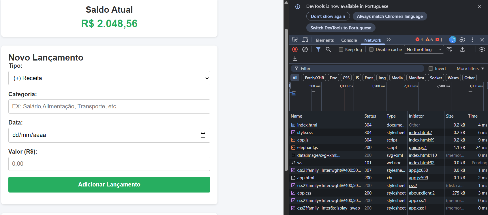

# MeuSaldo - Controle Financeiro Pessoal

Aplicação web simples desenvolvida para a atividade prática da disciplina de **Desenvolvimento de Sistemas Web (EECP0036)**, 2026.02.

---

## Sobre o App

O **MeuSaldo** ajuda o usuário no dia a dia a anotar e acompanhar as suas despesas e receitas. Com uma interface limpa e intuitiva, o app calcula e atualiza automaticamente o saldo total da carteira em tempo real.

### Funcionalidades (O que faz)
- Adiciona novos lançamentos informando Tipo (Receita ou Despesa), Descrição/Categoria, Data e Valor.
- Recalcula o saldo total instantaneamente a cada transação ou remoção.
- Mantém o histórico salvo no navegador utilizando `localStorage`.
- Validação contra entradas vazias ou valores inválidos sem travar a aplicação.

### Limitações (O que não faz)
- Não realiza autenticação/login de utilizadores.
- Não gera gráficos estatísticos nem relatórios em PDF.
- Não faz sincronização em nuvem entre aparelhos diferentes.

---

## Tecnologias Utilizadas

- **HTML5**: Estrutura semântica (`header`, `main`, `section`, `footer`, `label`).
- **CSS3**: Estilização responsiva (compatível com telemóvel e computador).
- **JavaScript (Vanilla / ES6)**: Lógica de manipulação do DOM e persistência local, utilizando `textContent` por questões de segurança contra vulnerabilidades XSS.
- **Trilha Escolhida**: **Trilha C** (Sem API externa, lógica local e armazenamento via `localStorage`).

---

## Como Rodar o Projeto

1. Clone este repositório para o seu computador:
   ```bash
   git clone https://github.com/SEU-USUARIO/meusaldo.git
   ```
2. Navegue até à pasta do projeto:
   ```bash
   cd meusaldo
   ```
3. Execute o servidor local via Python:
   ```bash
   python -m http.server 8000
   ```
   *(Ou utilize a extensão **Live Server** no VS Code).*
4. Abra o seu navegador e aceda ao endereço:
   `http://localhost:8000`

---

## Análise de Rede (Aba Network do Navegador)



> **Explicação da Imagem:**
> A captura de ecrã acima mostra a inspeção de rede (F12 > Network) durante o carregamento local do app via `Live Server`.

---

## Declaração de Uso de IA

- **Ferramenta de IA utilizada:** Gemini (Google).
- **O que foi solicitado:** Ferramenta utilizada para avaliar, validar e ajustar o código conforme ideias de implementação.
- **O que foi ajustado/alterado:** A organização das funções, tratamento de validação de formulários e a adição de regras do `localStorage`.

---

**Autor:** Pacelle Henrique Parnaíba Sobral 

**Curso:** Engenharia da Computação - UFMA  